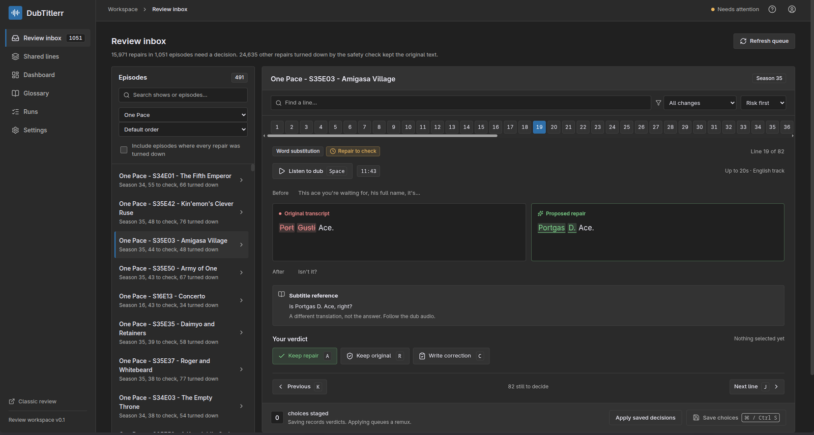
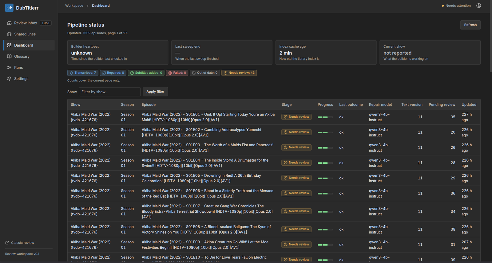
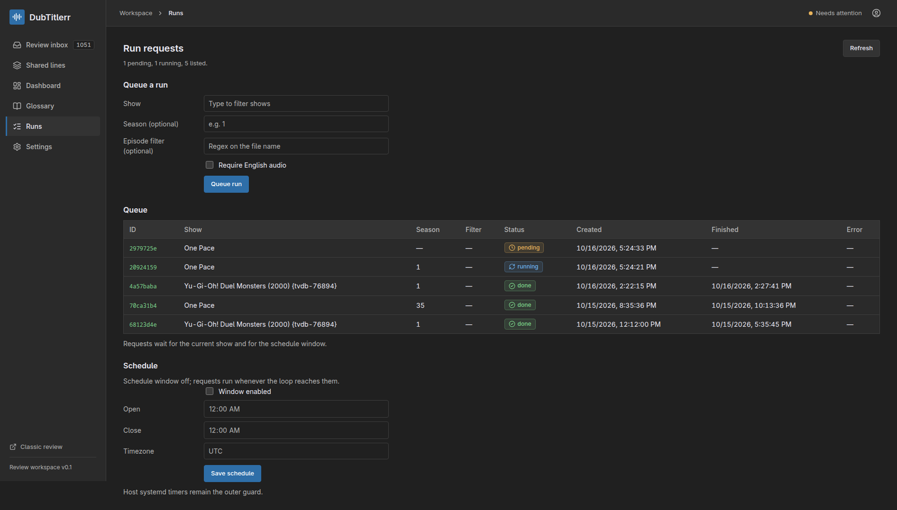
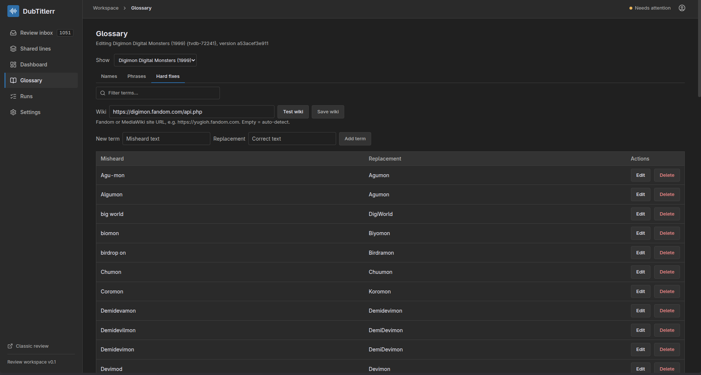
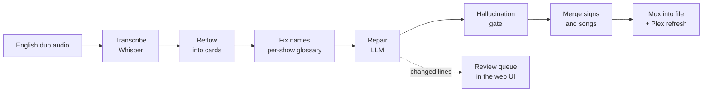

# DubTitlerr

[](https://github.com/XenaRathon/DubTitlerr/releases/latest)
[](https://github.com/XenaRathon/DubTitlerr/pkgs/container/dubtitlerr)
[](https://github.com/XenaRathon/DubTitlerr/actions/workflows/ci.yml)
[](LICENSE)


DubTitlerr transcribes English dub audio into subtitles and merges on-screen signs and songs into the same track.

## The problem

The English subtitles shipped with most anime translate the Japanese script, not the English dub, so watching dubbed with them on gives you two scripts at once.
Meanwhile the translated on-screen signs and songs live on a separate track, and most players show only one subtitle track at a time.
DubTitlerr produces one track that carries the dub dialogue with the signs and songs merged in.



<p>
  
  
  
</p>

## How it works



- Transcribe the English dub audio with Whisper (large-v3-turbo by default), then reflow words into clean cards (at most 2 lines, 42 chars, about 17 cps, never shown before spoken).
- Correct names against a per-show glossary (curated hard_fixes plus a guarded fuzzy match, mined from your files and wiki-verified).
- Repair low-confidence and name-suspect lines with an LLM over any OpenAI-compatible endpoint (your own llama.cpp or Ollama with qwen3-4b-instruct by default, or a hosted API), anchored on the embedded fansub dialogue when present.
- Drop hallucinated music, silence, and blocklist lines, collapse runaway repeats, and flag the uncertain for review.
- Merge the on-screen signs and song lyrics into the same subtitle.
- Mux the result into the file (mp4 episodes are remuxed to mkv) as a default Dubtitles track with the MKV fonts; English audio set default.
- Re-run safely: a version-stamped .dubtitles.done sidecar makes the pipeline idempotent and incremental.

## Features

- Web UI accounts and roles: admins manage settings and keys, users review and submit verdicts.
- Every pipeline setting listed under Settings in nine categories, with the first wave editable in place.
- Connections: named LLM endpoints (llama.cpp, Ollama, OpenAI-compatible) with write-only keys, tested and assigned per stage.
- Run requests with a schedule window on the Runs page, plus library sweep control.
- Sonarr and Radarr webhooks queue new downloads automatically.
- Review queue with audio previews, word diffs, staged batch saves, and shared-line review (classic page still at /).
- Per-show glossary mined from your files and wiki-verified, with a per-show wiki override.
- Per-episode Plex refresh as each episode finishes.

## Quickstart

```sh
curl -LO https://raw.githubusercontent.com/XenaRathon/DubTitlerr/main/compose.yaml
curl -L -o .env https://raw.githubusercontent.com/XenaRathon/DubTitlerr/main/.env.example
# edit .env: MEDIA_ROOT, ANIME_ROOT, and pin DUBTITLERR_TAG=v0.3.0
docker compose up -d
```

Then open `http://<host>:8842/review/setup` to create the admin account. Repair also needs a model endpoint, either one you run or a hosted API; the full setup, from model server to your first muxed show, is in [Your first show](https://github.com/XenaRathon/DubTitlerr/wiki/Your-First-Show).

## Requirements

- An NVIDIA GPU with CUDA for transcription; 6 GB is enough for either Whisper model at the default int8.
- Docker with the NVIDIA container runtime (install nvidia-container-toolkit on the host, or transcription falls back to CPU).
- An OpenAI-compatible endpoint for repair: llama.cpp serving qwen3-4b-instruct is the default, or use a hosted API with a key ([Repair with a hosted model](https://github.com/XenaRathon/DubTitlerr/wiki/How-To-Guides#repair-with-a-hosted-model)). A hosted API receives the lines it repairs.
- Everything else (ffmpeg, Python packages) is baked into the image, so there is nothing else to install.

## Documentation

| Page                                                                                         | What is there                                                             |
| -------------------------------------------------------------------------------------------- | ------------------------------------------------------------------------- |
| [Home](https://github.com/XenaRathon/DubTitlerr/wiki/Home)                                   | Start here: install path, per-episode pipeline, requirements.             |
| [Your first show](https://github.com/XenaRathon/DubTitlerr/wiki/Your-First-Show)             | Full walkthrough: one season from model server to muxed track.            |
| [How-to guides](https://github.com/XenaRathon/DubTitlerr/wiki/How-To-Guides)                 | Recipes for one problem each (queue, repair backend, accounts, webhooks). |
| [Reference](https://github.com/XenaRathon/DubTitlerr/wiki/Reference)                         | Every variable, glossary field, sidecar, stage outcome, and route.        |
| [Why it works this way](https://github.com/XenaRathon/DubTitlerr/wiki/Why-It-Works-This-Way) | The reasoning behind the guards, queues, and defaults.                    |
| [Choosing an ASR model](https://github.com/XenaRathon/DubTitlerr/wiki/Choosing-an-ASR-Model) | Measured evidence behind the transcription defaults.                      |
| [Agent guide](docs/AGENT-GUIDE.md)                                                           | Setup, troubleshooting, and contributing in agent-actionable form.        |

## Status

Beta: validated end to end on One Pace, Sword Art Online and Digimon. Version stamps may be invalidated without notice during the beta, so pin your image tag (for example `ghcr.io/xenarathon/dubtitlerr:v0.3.0`) instead of `:latest`.

## Roadmap

Planned work lives with the wiki: see the [roadmap](https://github.com/XenaRathon/DubTitlerr/wiki/Home#roadmap).

## License

GPL-3.0; see [LICENSE](LICENSE).

## A note on how this was built

This is 100% vibe-coded slop. I wrote it with Claude driving. But I didn't just say "make the thing with no mistakes." The whole project has specs, epics and stories, adversarial reviews (had other models try to break it), and real test coverage. I've been project managing it like an actual engineering effort, not a prompt-and-pray. I'm sharing it because it fills a gap I couldn't find a solution for, and I thought it might be a useful accessibility tool for people who want dub-matched subtitles without waiting for an official SDH release. This isn't meant to replace human-transcribed SDH subtitle tracks. Those are always going to be better. It's for when they don't exist.
